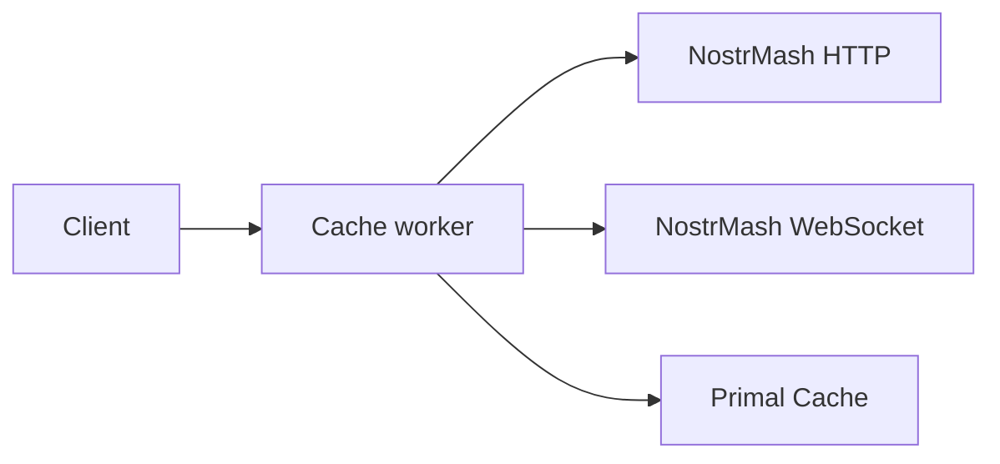

# SmartFlowSocial Cache Worker

[](https://github.com/xdzczk/smartflowsocial-cache-worker/actions/workflows/ci.yml)
[](LICENSE)
[](https://nodejs.org/)

Primal-compatible cache API for [SmartFlowSocial](https://smartflow.social). A Cloudflare Worker that reads NostrMash first, falls back to Primal Cache, and always returns Primal `EVENT` frames.

Part of SmartFlowSocial. Related pieces: [app](https://github.com/xdzczk/smartflowsocial), [publisher](https://github.com/xdzczk/smartflowsocial-publisher), [Blastr](https://github.com/xdzczk/smartflowsocial-blastr), [Blossom](https://github.com/xdzczk/smartflowsocial-blossom).

The GitHub repository is `smartflowsocial-cache-worker`. The Cloudflare script name in `wrangler.toml` stays `smartflowsocial-primal-cache-worker`.

## Contents

- [Features](#features)
- [Deployment](#deployment)
- [Usage](#usage)
- [Request types](docs/request-types.md)
- [Response format](#response-format)
- [Upstream order](#upstream-order)
- [Development](#development)

## Features

- HTTP POST interface for cache queries
- Native NostrMash reads for profiles, profile batches, events, and zap-free threads, translated back into Primal `EVENT` frames
- Fallback to the NostrMash Primal WebSocket compatibility socket, then to Primal Cache
- CORS support for browser-based applications
- Support for 80+ Primal cache request types
- Automatic connection retry with timeout handling

## Deployment

### Prerequisites

- Node.js 20+ and [pnpm](https://pnpm.io/) installed
- Cloudflare account
- Wrangler (via devDependencies; or install globally with `pnpm add -g wrangler`)

### Deploy to Cloudflare Workers

```bash
# Install dependencies
pnpm install

# Login to Cloudflare
pnpm exec wrangler login

# Deploy the worker
pnpm run deploy
```

## Usage

### Making Requests

Send a POST request to your worker URL with the following JSON body:

```json
{
	"requestType": "net_stats"
}
```

### Example using cURL

```bash
curl -X POST https://your-worker.workers.dev \
  -H "Content-Type: application/json" \
  -d '{
    "requestType": "thread_view",
    "params": {
      "event_id": "202cfc372f96c585cd9653a612a4274bfd4ac566a77b1d4dd235c5db24e003e8",
      "limit": 100
    }
  }'
```

### Example using JavaScript (Fetch API)

```javascript
const response = await fetch('https://your-worker.workers.dev', {
	method: 'POST',
	headers: {
		'Content-Type': 'application/json',
	},
	body: JSON.stringify({
		requestType: 'user_profile',
		params: {
			pubkey: '64-hex-pubkey-here',
		},
	}),
});

const data = await response.json();
console.log(data);
```

## Request types

The worker accepts the 89 `requestType` values in `src/data/primal-request-types.json`. Examples and the full list are in [Request types](docs/request-types.md).

## Response Format

The worker returns a Primal-shaped array of messages. NostrMash native HTTP answers are translated into that array. A NostrMash WebSocket or Primal answer is already in this shape:

```json
[
	["EVENT", "subscription-id", { "kind": 1, "content": "hello" }],
	["EOSE", "subscription-id"]
]
```

The last message is always `["EOSE", "subscription-id"]` indicating "End Of Stored Events".

## Error Handling

### HTTP Status Codes

- `200` - Success
- `400` - Bad request (invalid JSON, validation / unknown `requestType`, etc.)
- `405` - Method not allowed (only POST is accepted)
- `413` - Request body larger than 256 KiB
- `502` - Bad gateway (upstream error, malformed upstream payload, or all endpoints failed with non-timeout errors)
- `504` - Gateway timeout (connect or response timeout on every attempted endpoint)
- `500` - Unexpected internal error

Responses include an `X-Request-Id` header (echoed from the client `X-Request-Id` when valid, otherwise generated) for log correlation.

Successful responses also include `X-Cache-Source`:

- `nostrmash-native` — NostrMash `/api/v1`, reshaped into Primal `EVENT` / `EOSE` frames
- `nostrmash-ws` — NostrMash `wss://…/primal/ws/v1`
- `primal` — a Primal cache socket

### Error Response Format

```json
{
	"error": "Error message here"
}
```

Supported Primal `requestType` values are maintained in `src/data/primal-request-types.json` (validated before any upstream WebSocket is opened).

## Upstream order



For each POST, the worker tries:

1. **NostrMash native HTTP** (`NOSTRMASH_HTTP_BASE`, default `https://api.nostrmash.com`) for `user_profile`, `user_infos`, `events`, and `thread_view`. The JSON is translated into the same `EVENT` / `EOSE` array SmartFlowSocial already parses. A thread with zap receipts is not answered here, because `/api/v1/threads` does not include kind `9735` receipts.
2. **NostrMash WebSocket compatibility** (`NOSTRMASH_WS_URL`, default `wss://api.nostrmash.com/primal/ws/v1`). This is the Primal iOS cache protocol. The older `/primal/ws` socket is not used: its profile payload is not a kind `0` event.
3. **Primal Cache**, in order: `wss://cache.smartflowsocial.com/v1`, `wss://cache1.primal.net/v1`, `wss://cache2.primal.net/v1`.

A tier is skipped when it is unreachable, returns an error, or returns no events SmartFlowSocial can use. `event_actions` stays on Primal unless a tier returns events of the requested kind. NostrMash answers that call with profile metadata, which would hide likes and reposts.

Each socket uses a 3-second connect timeout and a 5-second response timeout. Native HTTP calls use a 2-second timeout (2.5 seconds for threads).

## CORS Support

The worker includes CORS headers allowing requests from any origin:

- `Access-Control-Allow-Origin: *`
- `Access-Control-Allow-Methods: GET, POST, OPTIONS`
- `Access-Control-Allow-Headers: Content-Type, X-Request-Id`
- `Access-Control-Expose-Headers: X-Request-Id, X-Cache-Source`

## Development

### Local Testing

```bash
# Run in development mode
pnpm run dev
```

This will start a local server using Wrangler for testing.

### Quality checks

```bash
pnpm run validate
```

Runs Prettier (check), ESLint, TypeScript, `cf-types:check`, and Vitest. After changing `wrangler.toml` or bindings, run `pnpm run cf-types` and commit `worker-configuration.d.ts` if it changes.

### Project Structure

```
.
├── src/
│   ├── index.ts                 # Worker fetch handler and upstream chain
│   ├── native-nostrmash.ts      # NostrMash `/api/v1` translation
│   ├── cache-socket.ts          # One Primal-style cache WebSocket call
│   ├── frames.ts                # EVENT frame helpers
│   ├── body-schema.ts           # Zod validation for POST JSON
│   ├── http-error.ts            # Typed HTTP errors
│   ├── request-types.ts         # Loads allowlist JSON
│   └── data/
│       └── primal-request-types.json   # Supported Primal requestType values
├── test/                        # Vitest + @cloudflare/vitest-pool-workers
├── worker-configuration.d.ts    # Generated: pnpm run cf-types
├── wrangler.toml
├── package.json
├── CONTRIBUTING.md
└── README.md
```

## License

Released into the public domain under the [Unlicense](LICENSE). This project follows the [Code of Conduct](CODE_OF_CONDUCT.md). Report security issues through [SECURITY.md](SECURITY.md).

## Contributing

See [CONTRIBUTING.md](./CONTRIBUTING.md). Pull requests are welcome.

## Support

For issues and questions, please open an issue on the GitHub repository.
